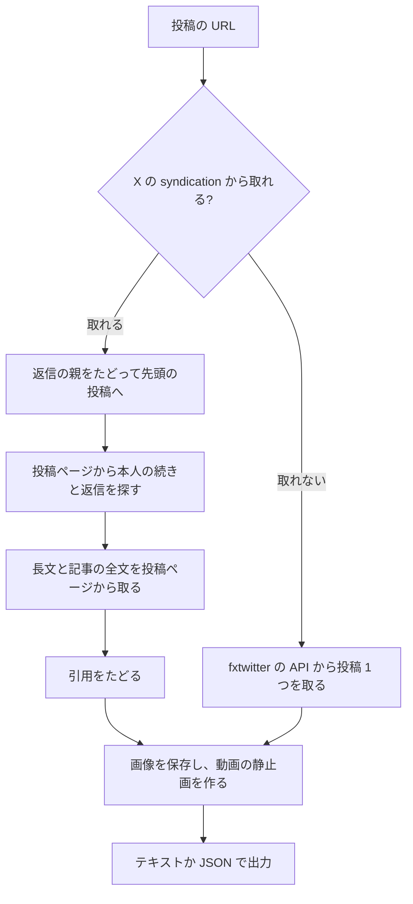

<div align="center">

# x-thread-reader

### X（旧 Twitter）の投稿をログインなしで丸ごと読む CLI

[](x_thread.py)
[](#インストール)
[](LICENSE)

**URL を 1 つ渡すと、連投・引用・返信・記事の全文・画像・動画の中身までまとめて読める**

---

</div>

## 概要

X の投稿の URL を渡すと、その投稿を含む連投の全体、引用された投稿、ほかの人の返信、長文や記事の全文、画像、動画、リンクのカードをまとめて取り出します。ログイン、API キー、ブラウザは要りません。Python の標準ライブラリだけで動く 1 つのファイルです。

[nyanshiba/muse-tan](https://github.com/nyanshiba/muse-tan) の `x_thread.py` をフォークしました。元は Muse のカスタムコネクタです。このフォークではコネクタの部分を除いて CLI だけにし、次の機能を足しました。

- 標準出力を UTF-8 にして、Windows でもそのまま動くようにした
- 画像・動画・GIF・リンクのカード・いいね数・返信数を出す
- 画像を保存し、動画から静止画を並べた 1 枚を作る
- X から取れない時は fxtwitter の API に切り替える
- URL を何個でも一度に渡せる

## 特徴

| 取れるもの | 内容 |
|---|---|
| 連投 | 途中の投稿から始めても、先頭まで戻ってから本人の続きをたどる |
| 引用 | 引用の引用も、新しい引用が出てこなくなるまでたどる |
| 返信 | ほかの人の返信は本人の連投と分けて出す |
| 長文・記事 | 長文の投稿と X の記事は、投稿ページから全文を取る。記事は見出しとコードブロックも残す |
| 画像 | URL・大きさ・代替テキストを出す。`--media-dir` で保存する |
| 動画・GIF | 長さと mp4 の URL を出す。`--frames` で静止画を並べた 1 枚を作る（動画全体はダウンロードしない） |
| リンクのカード | リンク先のタイトル・説明・ドメイン・URL |
| 数 | いいね数・返信数 |
| 予備の取得先 | 始めの投稿が X から取れない時は、fxtwitter の API から投稿 1 つを取る |

## 処理フロー



## インストール

```bash
git clone https://github.com/cUDGk/x-thread-reader.git
cd x-thread-reader
```

Python 3 だけで動きます。pip で入れるものはありません。`--frames` を使う時だけ、ffmpeg を PATH に置いてください。

Windows 11 と Python 3.12、ffmpeg 7.1 で確認しています。

## 使い方

```bash
# 投稿と、それを含む連投の全体
python x_thread.py "https://x.com/<user>/status/<id>"

# 画像も保存する
python x_thread.py "https://x.com/<user>/status/<id>" --media-dir media

# 動画から静止画 6 枚を取り、1 枚に並べる
python x_thread.py "https://x.com/<user>/status/<id>" --media-dir media --frames 6

# プログラムで扱う JSON で出す
python x_thread.py "https://x.com/<user>/status/<id>" --json

# 複数の投稿を一度に読む
python x_thread.py "https://x.com/<user>/status/<id1>" "https://x.com/<user>/status/<id2>"
```

| オプション | 内容 |
|---|---|
| `--json` | JSON で出す。URL が 2 個以上の時は配列になる |
| `--mode post` | 投稿 1 つだけを読む。速いが、長文は途中で切れることがある |
| `--media-dir DIR` | 画像を `<投稿 ID>_<番号>.jpg` で保存する。動画と GIF は表紙の画像を保存する |
| `--frames N` | 動画と GIF から N 枚（1〜12）の静止画を取り、横 3 枚ずつ並べた `<投稿 ID>_<番号>_frames.jpg` を作る。`--media-dir` と ffmpeg が要る |

渡せる URL は `x.com`・`twitter.com`・`fxtwitter.com`・`vxtwitter.com` の投稿の URL、`publish.twitter.com` の埋め込みの URL、投稿 ID の数字です。

### 出力の例

```text
[x-thread] @example_author / 2 posts / root=1900000000000000001 / start=1900000000000000002 / source=syndication

1. 1900000000000000001 · 2025-01-01T00:00:00.000Z · likes=10 replies=1
Example post 1900000000000000001
   [card] Example title | Example description | github.com | https://github.com/example/example-repo

2. 1900000000000000002 · 2025-01-01T00:00:00.000Z · likes=3 replies=0
Example post 1900000000000000002
   [photo 1] https://pbs.twimg.com/media/EXAMPLEPHOTO.jpg 1200x800 alt="example alt text"
   [photo 1 file] media/1900000000000000002_1.jpg

[x-thread] quoted by the thread (1):
- 1900000000000000009 · @example_quote · quoted by 1900000000000000001
  Example quote
```

例の中身は、試験の作り物の見本から出したものです。

### 終了コード

| コード | 意味 |
|---|---|
| `0` | すべて取れた |
| `2` | 投稿の URL か ID ではない |
| `3` | 始めの投稿が X からも fxtwitter からも取れなかった（削除された、鍵がかかっている、年齢制限がある、取得先の仕様が変わった、など） |

URL を複数渡した時は、最初に失敗したもののコードを返します。

### 使う時の注意

- X の syndication（`cdn.syndication.twimg.com`）は非公式で、使い方の説明もありません。予告なく変わったり止まったりすることがあります。
- 読みたい投稿を 1 つずつ読むための道具です。タイムラインをまとめて集めたり、同じ投稿を繰り返し取ったりしないでください。取った投稿の中身を再配布しないでください。X の利用規約を守ってください。
- 返信はログインなしで見える分だけです。返信の中の長文は途中で切れたままです。
- 削除された投稿、鍵のかかった投稿、年齢制限のある投稿は読めません。

### 試験

```bash
python -m unittest discover -s tests
```

試験はネットにつながりません。見本はすべて作り物です。ffmpeg が無い時は、静止画の試験だけを飛ばします。

## Attribution

- 元のコード: [nyanshiba/muse-tan](https://github.com/nyanshiba/muse-tan) の `x_thread.py`（MIT）。nyanshiba さんの OpenCode プラグイン `x-thread`（[nyanshiba/harness-bonsai](https://github.com/nyanshiba/harness-bonsai)、MIT）を、Museたんが Python に移したものです。
- 予備の取得先: [FxEmbed](https://github.com/FxEmbed/FxEmbed)（旧 FxTwitter）の API（`api.fxtwitter.com`）。

## ライセンス

[MIT](LICENSE)。元の著作権表示（nyanshiba）も残しています。
